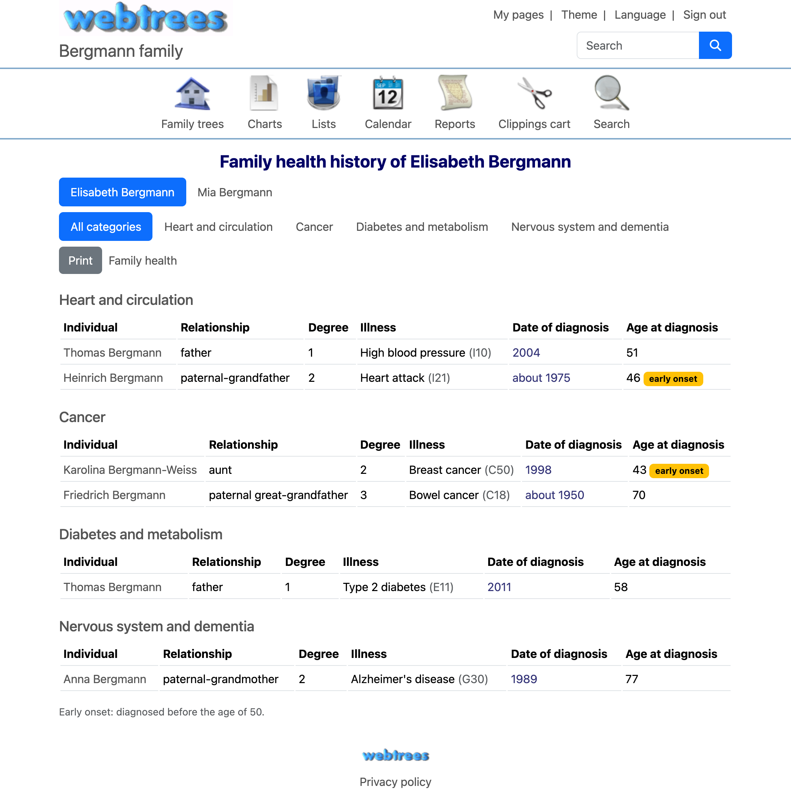
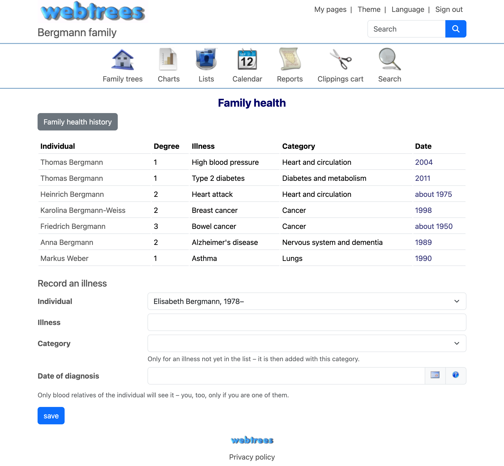
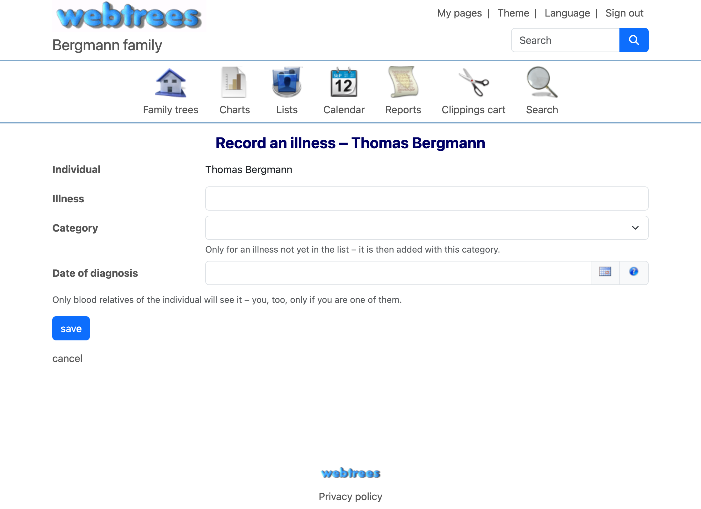
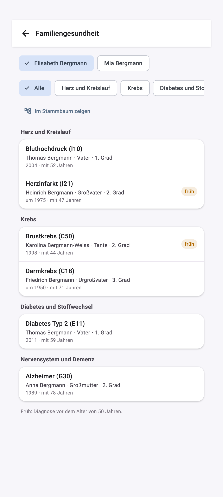

# Family Health History für webtrees

[English](README.md)

Erkrankungen im Stammbaum erfassen und für den Arzt zusammenfassen: *„Gab es das in Ihrer Familie schon?“*

Funktioniert besonders gut zusammen mit der App [webtrees-mobile](https://github.com/Schoaf/webtrees-mobile) – siehe
[Auf dem Handy](#auf-dem-handy).



## Wie Erkrankungen gespeichert werden

Als gewöhnliche GEDCOM-Fakten, lesbar für jedes Genealogie-Programm:

```
1 FACT Diabetes mellitus Typ 2
2 TYPE Illness
2 DATE ABT 1960
2 RESN confidential
```

`RESN confidential` hält sie auf den webtrees-Seiten von allen fern außer Managern und Admins.

## Wer was sieht

Das Modul zeigt eine Erkrankung nur

- Blutsverwandten der Person, die dem eigenen Konto zugeordnet ist, und
- Blutsverwandten der eigenen Kinder unter 18 – so sieht ein Elternteil auch die Linie des anderen.

Der Grad ist der genetische, nach dem Ärzte fragen: Eltern, Kinder und Geschwister 1., Großeltern, Tanten, Onkel,
Nichten, Neffen und Halbgeschwister 2., Cousins und Cousinen 3. Adoptiv- und Pflegeverhältnisse (`2 PEDI`) zählen
nicht. Die Regel gilt auch für Admins; ein Konto ohne zugeordnete Person sieht keine. Auf Wunsch begrenzt auf einen
Verwandtschaftsgrad (Verwaltung → Module → Familiengesundheit).

## Katalog und Kategorien

Jede Erkrankung hat eine Kategorie und auf Wunsch einen ICD-10-Code – am Namen, nicht an jedem Eintrag, damit sie
überall gleich bleibt. Kategorien: Herz und Kreislauf, Krebs, Diabetes und Stoffwechsel, Autoimmun, Nervensystem und
Demenz, Psychische Gesundheit, Lunge, Niere, Erbliche Syndrome, Sonstiges. Eine Erkrankung, die nicht im Katalog
steht, zählt als *Sonstiges*.

Der Katalog beginnt mit rund 40 häufigen Erkrankungen in der Sprache der Website (Deutsch oder Englisch) und wird in den
Einstellungen des Moduls gepflegt. Dort stehen auch Namen, die in einem Stammbaum vorkommen, aber im Katalog fehlen.
JSON `Catalog/{baum}` liefert Apps die Kategorien und den Katalog als Vorschläge beim Eintragen. Er enthält nur Namen,
nie, wer betroffen ist.

## Erkrankung eintragen

Bearbeiter finden auf der Seite „Familiengesundheit“ ein Formular: Person, Erkrankung (Vorschläge aus dem Katalog),
Datum der Diagnose und – bei einem Namen, der noch nicht im Katalog steht – seine Kategorie, mit der er dort aufgenommen
wird. Das Modul schreibt den Fakt selbst, immer `2 TYPE Illness` (webtrees zeigt es übersetzt;
*Erkrankung* und *Krankheit* werden ebenso gelesen) und `2 RESN confidential`; er geht wie jede Änderung durch die ausstehenden Änderungen. Auch der Bearbeiter sieht ihn danach
nur, wenn er blutsverwandt ist.

Dasselbe Formular öffnet sich auf der Personenseite: *Tatsache hinzufügen* → *Erkrankung*. webtrees kennt keinen
Einstiegspunkt für ein eigenes Formular je Tatsache, deshalb stellt sich das Modul vor die webtrees-Seite *Tatsache
hinzufügen* und leitet nur diesen Eintrag zu seinem Formular; der Eintrag selbst kommt nie in den Stammbaum.

 

## Familienanamnese

Die Schaltfläche *Familienanamnese* auf der Seite öffnet, was ein Arzt fragt: für die eigene Person – oder eines der
eigenen Kinder unter 18 – die Erkrankungen ihrer Blutsverwandten, nach Kategorie gruppiert. Jeweils mit Beziehung
(*Mutter*, *Großvater*), Grad, ICD-10-Code aus dem Katalog, Datum der Diagnose und Alter bei Diagnose. Eine Erkrankung,
die vor einem festgelegten Alter diagnostiziert wurde (Standard 50, in den Einstellungen änderbar, 0 = aus), ist als
*früh aufgetreten* markiert. Ein Filter zeigt nur eine Kategorie; *Drucken* lässt die Bedienelemente weg und ergänzt
das Datum. Die eigenen Erkrankungen der Person gehören nicht dazu, und es erscheint nur, was die Sichtbarkeitsregel
erlaubt.

## Auf dem Handy

Die App [webtrees-mobile](https://github.com/Schoaf/webtrees-mobile) (Android und iOS, mit
[api4webtrees](https://github.com/thobgg/api4webtrees)) zeigt die Familienanamnese dort, wo man sie braucht – beim Arzt:
nach Kategorie, mit Filter, früh aufgetretene markiert, und *Im Stammbaum zeigen* blendet alle ohne Erkrankung aus.
Eintragen geht in der App ebenso. Die App erkennt das Modul von selbst; einzurichten ist nichts.



[App Store](https://apps.apple.com/app/id6815108154) · [Google Play](https://play.google.com/store/apps/details?id=net.webtrees.webtreesmobile)

## JSON für Apps

Dieselbe Sitzung und derselbe CSRF-Token wie webtrees (und api4webtrees), Route `/module/_family-health_/<Action>/{baum}`
– die Tabelle steht in der [englischen README](README.md#json-for-apps).

## Installation

Das ZIP aus dem [neuesten Release](https://github.com/Schoaf/webtrees-family-health/releases/latest) nach `modules_v4/`
entpacken – es enthält den Ordner `family-health` – und das Modul einschalten. Braucht webtrees 2.2 und PHP 8.3.

Ein neues Release: Version in `customModuleVersion()` und `latest-version.txt` setzen, *Unreleased* in `CHANGELOG.md`
darauf umbenennen und den Tag `v<Version>` pushen. Der Workflow lässt die Tests laufen, baut das ZIP und
veröffentlicht das Release mit dem Abschnitt aus dem Changelog als Text.

## Tests

`python3 tests/test_modul.py` baut ein frisches webtrees 2.2.6 mit SQLite unter `php -S` auf (nur 127.0.0.1) und
testet dagegen.
`tests/screenshots.py` macht auf dieselbe Weise die Screenshots in `docs/`, aus der Demo-Familie in `tests/demo.ged`
(braucht Google Chrome und `pip install websocket-client`).

## Buy me a bagel 🥯

Die Arbeit an diesem Projekt kostet Zeit und Geld. Wenn du das Projekt unterstützen möchtest, lad mich auf einen Bagel ein: Scanne den QR-Code mit deiner Banking-App.


Andreas Scharf · IBAN DE59 1001 1001 2074 1651 75 · BIC NTSBDEB1XXX

Danke, und guten Appetit mir! 🙂

## Lizenz

GPL-3.0, wie webtrees.
