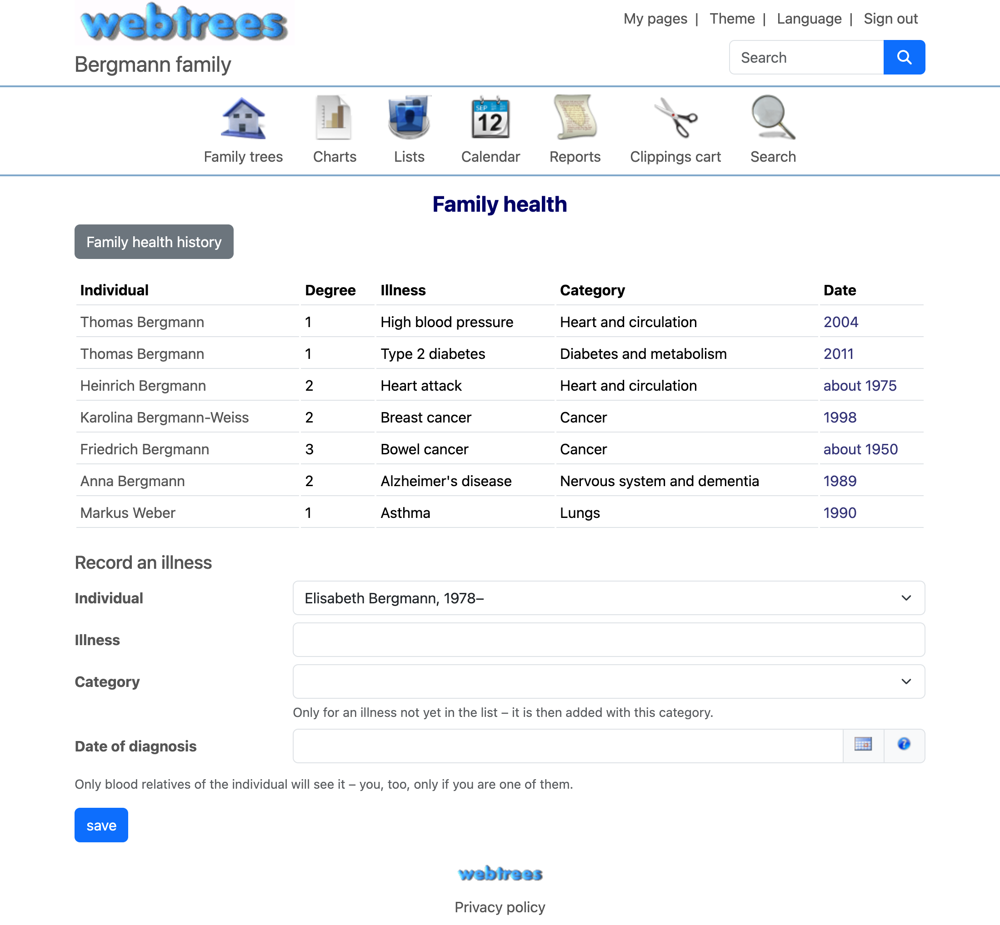
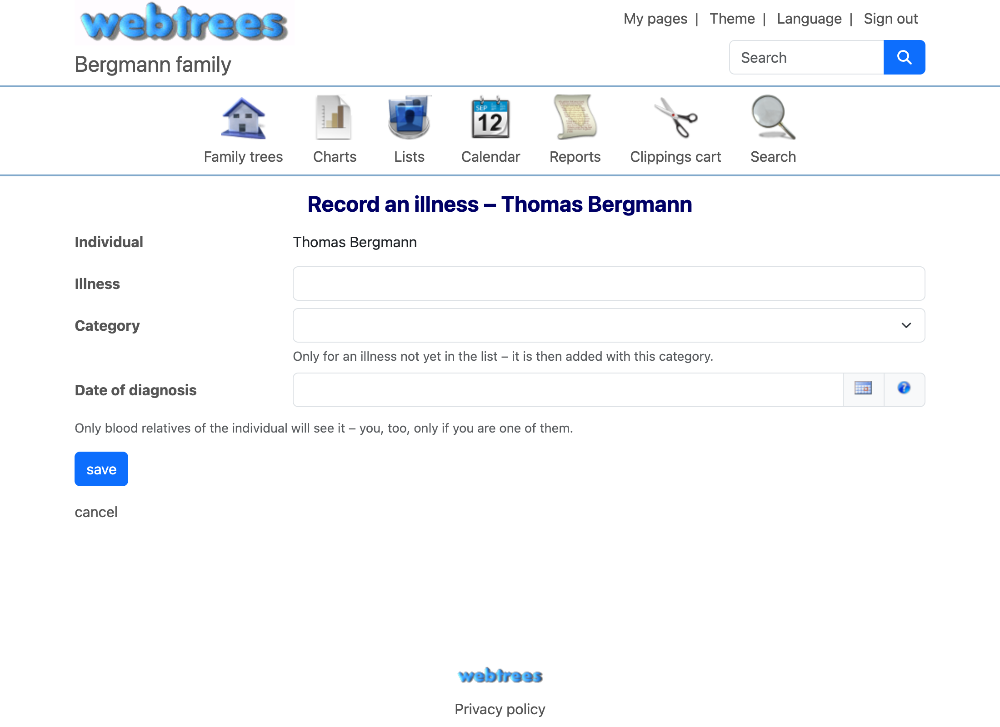
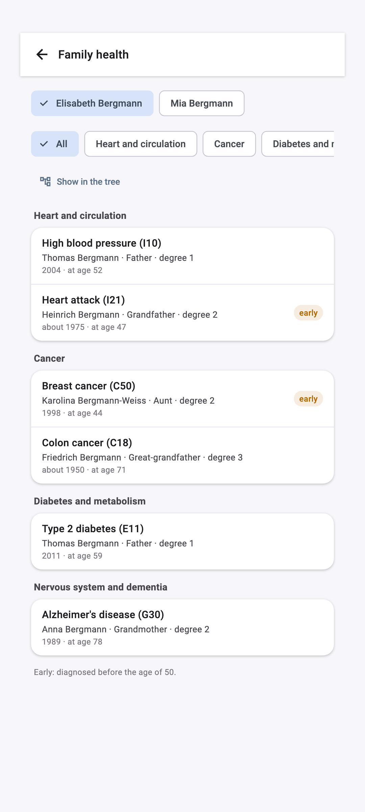

# Family Health History for webtrees

[Deutsch](README.de.md)

Record illnesses in your family tree and sum them up for the doctor: *"Any cases of this in your family?"*

Works especially well together with the [webtrees-mobile](https://github.com/Schoaf/webtrees-mobile) app – see
[On the phone](#on-the-phone).


## How illnesses are stored

As plain GEDCOM facts, readable by any genealogy program:

```
1 FACT Diabetes mellitus Typ 2
2 TYPE Illness
2 DATE ABT 1960
2 RESN confidential
```

`RESN confidential` keeps them away from webtrees' own pages for everyone but managers and admins.

## Who sees what

The module shows an illness only to

- blood relatives of the individual linked to your account, and
- blood relatives of your own children under 18 – so a parent sees the other parent's line.

The degree is the genetic one a doctor asks about: parents, children and siblings 1st, grandparents, aunts, uncles,
nieces, nephews and half siblings 2nd, first cousins 3rd. Adoptive and foster links (`2 PEDI`) don't count. The rule
holds for admins too; an account without a linked individual sees none. Optionally limited to a degree of
relationship (control panel → Modules → Family health).

### Not taking part

Anyone can opt out: then nobody sees their illnesses – no relative, not they themselves, not an admin – and none can be
recorded for them. You decide for yourself and for your children under 18 on the page *Family health*; a manager of the
tree can take out anyone there, for instance when someone asks by e-mail. The facts stay in the tree and show again
once the individual takes part again. webtrees itself still shows the confidential facts to managers on the
individual's page.

## Catalog and categories

Each illness name has a category and, optionally, an ICD-10 code – the name, not each entry, so it stays the same
everywhere. Categories: heart and circulation, cancer, diabetes and metabolism, autoimmune, nervous system and dementia,
mental health, lungs, kidneys, hereditary syndromes, natural cause of death, unnatural cause of death, other. An
illness not in the catalog counts as *other*. Administrators rename, add and delete categories in the module's settings;
the illnesses of a deleted category go to *other*, which stays.

The catalog starts with about 40 common illnesses in the site's language (German or English) and is edited in the
module's settings, which also list names used in a tree but missing from the catalog. Renaming a name there offers to
rename it for every individual who has it as well. The catalog is one alphabetical list, sortable by each column,
with the number of individuals per name – a link to exactly those individuals. JSON `Catalog/{tree}` gives apps
the categories and the catalog, as suggestions when entering an illness. It holds only names, never who has them.

## Recording an illness

Editors find a form on the page "Family health": individual, illness (suggested from the catalog), date of diagnosis
and – for a name not in the catalog yet – its category, which adds it there. The module writes the fact itself,
always `2 TYPE Illness` (webtrees shows it translated; *Erkrankung* and *Krankheit* are read as well) and
`2 RESN confidential`; it goes through pending
changes like any edit. The editor, too, sees it afterwards only if they are a blood relative.

The same form opens from an individual's page: *Add a fact* → *Illness*. webtrees has no hook for a form of its own
per fact, so the module puts itself in front of webtrees' page *Add a fact* and sends only this entry to its form; the
entry itself never reaches the tree.

 

## Family health history

The button *Family health history* on the page opens what a doctor asks for: for your own individual – or one of your
children under 18 – the illnesses of their blood relatives, grouped by category. Each with the relationship
(*mother*, *grandfather*), the degree, the ICD-10 code from the catalog, the date of diagnosis and the age at diagnosis.
An illness diagnosed before a set age (default 50, changeable in the settings, 0 = off) is marked *early onset*.
A filter shows one category only; *Print* leaves out the controls and adds the date. The individual's own illnesses
are not part of it, and it only ever shows what the visibility rule lets you see.

## On the phone

The [webtrees-mobile](https://github.com/Schoaf/webtrees-mobile) app (Android and iOS, with
[api4webtrees](https://github.com/thobgg/api4webtrees)) shows the family health history where you need it – at the
doctor's: by category, with a filter, early onset marked, and *Show in the tree* fades everyone without an illness.
Illnesses are recorded in the app as well. The app finds the module on its own; nothing to set up.



[App Store](https://apps.apple.com/app/id6815108154) · [Google Play](https://play.google.com/store/apps/details?id=net.webtrees.webtreesmobile)

## JSON for apps

Same session and CSRF token as webtrees (and api4webtrees), route `/module/_family-health_/<Action>/{tree}`:

| Action | | |
|---|---|---|
| `Illnesses` | GET | the illnesses you may see: `xref`, `name`, `illness`, `category`, `date`, `degree` |
| `Catalog` | GET | `categories` (`id`, `name`) and the catalog `illnesses` (`name`, `category`, `icd`) |
| `FamilyHistory` | GET | the family history, `?xref=` your own individual (default) or a child under 18: `subjects` (`xref`, `name`), `xref`, `earlyAge` and `illnesses` (`xref`, `name`, `relationship`, `degree`, `illness`, `category`, `icd`, `date`, `dateText`, `age`, `isEarly`) |
| `Illness` | POST | record one, editors only: `{"xref", "illness", "date"?, "category"?}` → `{"ok": true}` or 400 with `error` |
| `PersonIllnesses` | GET | the illnesses of `?xref=` for their page, if you may see them: `illnesses` (`id`, `illness`, `category`, `icd`, `date`, `dateText`, `isPending`) and `canEdit`; causes of death are left out |
| `IllnessUpdate` | POST | change one, editors only: `{"xref", "id", "illness", "date"?, "category"?}` – other lines under the fact stay; answers like `Illness` |
| `Participation` | GET | `subjects` (`xref`, `name`, `isOptedOut`) you decide for, `canManage` and, for a manager, `optedOut` (`xref`, `name`) |
| `Participation` | POST | `{"xref", "isOptedOut": true\|false}` – yourself, a child under 18, or anyone for a manager; answers like `Illness` |
| `IllnessDelete` | POST | delete one, editors only: `{"xref", "id"}`; answers like `Illness` |

## Installation

Unpack the ZIP from the [latest release](https://github.com/Schoaf/webtrees-family-health/releases/latest) into
`modules_v4/` – it holds the folder `family-health` – and enable the module. Requires webtrees 2.2 and PHP 8.3.

A new release: set the version in `customModuleVersion()` and `latest-version.txt`, rename *Unreleased* in
`CHANGELOG.md` to it and push the tag `v<version>`. The workflow runs the tests, builds the ZIP and publishes the
release with the changelog section as notes.

## Tests

`python3 tests/test_modul.py` sets up a fresh webtrees 2.2.6 with SQLite under `php -S` (127.0.0.1 only) and tests
against it.
`tests/screenshots.py` makes the screenshots in `docs/` the same way, from the demo family in `tests/demo.ged` (needs
Google Chrome and `pip install websocket-client`).

## Buy me a bagel 🥯

Working on this project takes time and money. If you'd like to support it, buy me a bagel: scan the QR code with your banking app.


Andreas Scharf · IBAN DE59 1001 1001 2074 1651 75 · BIC NTSBDEB1XXX

## Licence

GPL-3.0, like webtrees.
